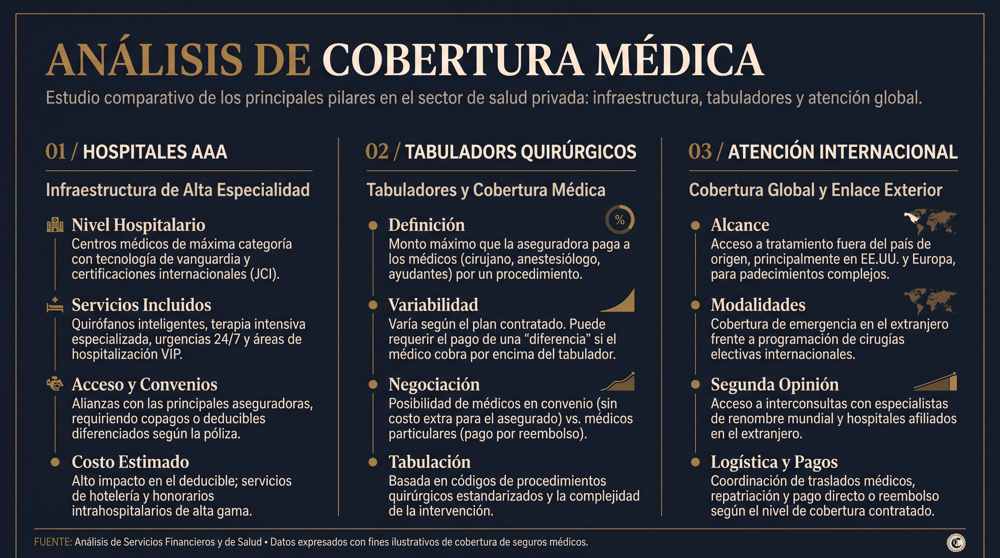

Elegir una póliza de **Gastos Médicos Mayores (GMM)** para un perfil directivo o empresarial no se reduce a buscar el precio más bajo. La verdadera métrica de evaluación radica en la **certeza operativa en momentos de crisis**: acceso inmediato a los mejores hospitales del país, tabuladores médicos que cubran a los cirujanos top y una gestión burocrática sin fricciones.

En el mercado mexicano, **AXA, MetLife y GNP** concentran la mayor participación en el sector de alta especialidad. A continuación, presentamos una auditoría imparcial de sus ofertas para perfiles de alta exigencia.

## 1. Flexibilidad de Tabuladores Médicos (Honorarios Quirúrgicos)

Uno de los principales motivos de insatisfacción durante una intervención quirúrgica es el **pago por diferencia de tabulador**: cuando el cirujano cobra honorarios por encima de lo que la aseguradora tiene estipulado en su contrato base.

- **AXA Seguros:** Ofrece tabuladores altamente modularizables en sus planes de gama alta (Flex Plus). Permite incrementar la suma asegurada para honorarios quirúrgicos hasta niveles alineados con los especialistas más reconocidos de CDMX, Monterrey y Guadalajara.
- **GNP Seguros:** En sus planes de alta gama (Línea Azul / Alta Especialidad), cuenta con un catálogo de convenios médicos muy amplio. Sin embargo, en ciudades secundarias o procedimientos de ultra-especialidad, requiere una estructuración cuidadosa del nivel de tabulador para evitar desembolsos fuera de bolsillo.
- **MetLife:** Destaca por la estabilidad de sus primas en renovaciones anuales y convenios sólidos con equipos quirúrgicos institucionales. Para perfiles ejecutivos, es indispensable contratar el endoso de tabulador alto para garantizar la cobertura total de cirujanos privados independientes.

## 2. Deducibles, Coaseguros y Topes de Participación

La estructura financiera de la póliza define la aportación máxima que realizarías en una emergencia médica.

| Aseguradora | Opción de Deducible Cero por Accidente | Tope de Coaseguro | Modalidad de Pago Directo |
| :--- | :--- | :--- | :--- |
| **AXA** | Disponible vía endoso específico | Configurable (Sugerido $50,000 - $70,000 MXN) | Excelente en hospitales de convenio |
| **GNP** | Incluido en esquemas preferentes | Configurable (Topes competitivos en nivel AAA) | Digitalizado vía app y concierge |
| **MetLife** | Disponible según diseño del plan | Muy estable / Topes protegidos contra inflación | Tramitación directa con red hospitalaria |

## 3. Redes Hospitalarias y Nivel de Cobertura (Hospitales AAA)

Para directivos y empresarios, garantizar la admisión en instituciones como el **Centro Médico ABC (Observatorio y Santa Fe), Hospital Español, Médica Sur, Grupo Ángeles o Doctors Hospital** es una condición no negociable.

- **GNP Seguros:** Es tradicionalmente el jugador con la presencia institucional más fuerte en el segmento de hospitales AAA en México. Sus convenios directos simplifican significativamente el proceso de admisión e ingreso hospitalario.
- **AXA Seguros:** Ofrece una de las mejores arquitecturas para cobertura internacional (EE.UU. y Europa) mediante alianzas estratégicas globales, ideal para ejecutivos con viajes frecuentes o residencia compartida.
- **MetLife:** Mantiene una cobertura robusta en red nacional con una relación costo-beneficio sumamente competitiva en el segmento individual y familiar.

## 4. Gestión de Crisis y Servicio Concierge

En una emergencia de salud, el factor tiempo es crítico. Escuchar una grabación telefónica de 15 minutos para autorizar una carta pase es inaceptable para una agenda saturada.

**La diferencia Nubenca:** Independientemente de si tu póliza se emite con AXA, GNP o MetLife, en **Nubenca** actuamos como tu **Concierge Financiero y Gestor de Crisis**. Nosotros asumimos la relación directa con el área de dictamen de la aseguradora, coordinamos los pagos directos y gestionamos el reembolso de medicamentos de alta especialidad.

## ¿Cuál es la mejor opción para tu perfil?

- **Elige AXA** si buscas máxima flexibilidad para modular coberturas internacionales y personalizar el tabulador de honorarios médicos a la medida de tu equipo de cirujanos de confianza.
- **Elige GNP** si valoras la fuerza de convenio local y el acceso sin fricciones a la red de hospitales AAA más amplia del país.
- **Elige MetLife** si buscas un balance óptimo entre sumas aseguradas robustas, estabilidad de prima a mediano plazo y protección familiar integral.

## Audita y Compara tu Póliza con Datos Duros

No tomes decisiones basadas en folletos comerciales de una sola aseguradora. En **Nubenca**, filtramos el mercado y preparamos una comparativa cuantitativa en menos de 24 horas.
