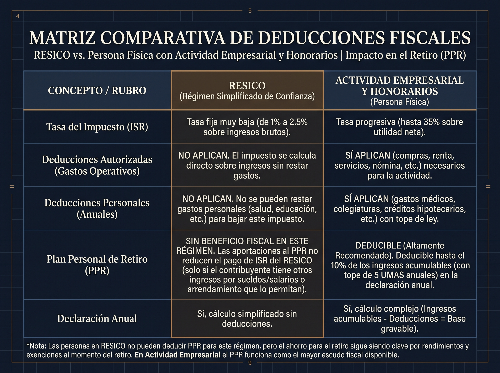

Existe una confusión generalizada sobre la deducibilidad de las pólizas de vida en México. Mientras que algunos asesores afirman categóricamente que "ningún seguro de vida paga impuestos", la realidad jurídica y fiscal ante el Servicio de Administración Tributaria (SAT) es considerablemente más matizada.

## ¿Los seguros de vida son deducciones personales?

**Sí, pero solo en ciertos casos.** Un seguro de vida es deducible cuando está estructurado como un instrumento de ahorro para el retiro (Plan Personal de Retiro o Cuenta Especial para el Ahorro) contratado por una Persona Física en régimen general. Un seguro de vida puro —enfocado únicamente en proteger a tus beneficiarios ante un fallecimiento, sin componente de retiro— **no es una deducción personal** ante el SAT, aunque sí tiene otro beneficio fiscal relevante: la suma asegurada que reciben tus beneficiarios está exenta de ISR.

En resumen: **depende directamente de tu Régimen Fiscal y de la estructura legal de la póliza contratada**. A continuación, analizamos las reglas del juego para Personas Físicas con Actividad Empresarial, Servicios Profesionales, contribuyentes en el Régimen Simplificado de Confianza (RESICO) y Personas Morales.

## Seguro de vida deducible para personas físicas (régimen general vs RESICO)

No todas las Personas Físicas tributan bajo las mismas reglas ni con los mismos privilegios de deducción.

### A. Persona Física con Actividad Empresarial o Servicios Profesionales (Honorarios)

Si tributas bajo este régimen, **sí puedes hacer deducible la aportación a un instrumento de vida**, siempre y cuando esté estructurado bajo esquemas específicos de la Ley del Impuesto Sobre la Renta (LISR):

- **Plan Personal de Retiro / PPR (Art. 151, Fracc. V de la LISR):** Permite deducir hasta el 10% de tus ingresos acumulables al año (con un tope de 5 UMAS anuales). Si tu póliza de vida incluye un componente de ahorro/jubilación enfocado al retiro a los 65 años, este beneficio aplica directamente en tu declaración anual. <!-- TODO: confirmar que el porcentaje y el tope de UMAs sigan vigentes para el ejercicio fiscal 2026. -->
- **Cuentas Especiales para el Ahorro (Art. 185 de la LISR):** Permite deducir hasta **$152,000 MXN adicionales al año**, independientemente del tope del Artículo 151. <!-- TODO: verificar si esta cifra ($152,000 MXN) ya fue actualizada por el SAT para 2026. -->

### B. Contribuyentes en RESICO (Régimen Simplificado de Confianza)

El marco legal del RESICO establece tasas de ISR preferenciales muy reducidas (del 1% al 2.5% sobre ingresos cobrados). <!-- TODO: confirmar que las tasas de RESICO (1%-2.5%) sigan vigentes para 2026. --> A cambio de este beneficio de tasa baja:

- **No se permiten deducciones personales:** Los contribuyentes en RESICO no pueden restar primas de seguros de vida tradicionales ni de gastos médicos en su declaración anual de ISR.
- **Excepción Estratégica:** Si cuentas con ingresos mixtos (por ejemplo, RESICO por tu negocio o clínica, más ingresos por Sueldos/Asimilados o Arrendamiento), es posible aplicar la deducción personal sobre la base gravable no proveniente de RESICO.

## Seguro de Vida Puro vs. Seguro de Vida con Ahorro/Retiro

Es fundamental diferenciar el propósito primario del contrato:

### Seguro de Vida Puro (Protección por Fallecimiento/Invalidez)

Las primas de un seguro de vida individual contratado a título personal (sin componente de retiro normado por el Art. 151 o 185) **no son deducibles de ISR para una Persona Física en su declaración anual**. Sin embargo, tienen una ventaja patrimonial crítica: **la suma asegurada pagada a tus beneficiarios en caso de fallecimiento está exenta de ISR** (Art. 93 de la LISR).

### Seguro de Vida Estructurado para el Retiro (PPR / Art. 185)

Cuando la póliza se diseña como un instrumento de ahorro e inversión a largo plazo registrado ante la SHCP, las aportaciones son deducibles al 100% durante tu etapa productiva, generando una devolución directa de saldo a favor cada año.

## Seguros de vida deducibles para personas morales

Si operas a través de una Persona Moral (S.A. de C.V., S.A.P.I., S.C.), la empresa puede contratar la póliza bajo la figura de **Seguro Hombre Clave** (Art. 27, Fracc. XII de la LISR). En este esquema, las primas pagadas por la empresa para proteger tu vida o la de tus socios son **100% deducibles de ISR como gasto operativo para la compañía**, logrando un doble propósito: blindaje corporativo y optimización de flujos empresariales. Si quieres entender a detalle cómo funciona, cuánto cuesta y quién debe contratarlo, revisa nuestra guía de [Seguro de Hombre Clave en México](/blog/seguro-hombre-clave-proteccion-empresarial-socios).

## Requisitos del SAT para deducir un seguro de vida

| Requisito | PPR (Art. 151) | Cuentas Especiales (Art. 185) |
| :--- | :--- | :--- |
| **Forma de pago** | Bancarizada: transferencia, cheque nominativo o tarjeta a nombre del titular. Sin efectivo. | Igual — pago bancarizado y rastreable. |
| **Permanencia mínima** | Retiro a partir de los 65 años, o cumplir el plazo que marque el contrato. | Orientado al ahorro de largo plazo; el retiro anticipado puede perder el beneficio fiscal. <!-- TODO: confirmar la mecánica exacta de retención si hay retiro antes de tiempo. --> |
| **Tope de deducción** | 10% de ingresos acumulables, máximo 5 UMAs anuales. | Hasta $152,000 MXN adicionales al año. |
| **CFDI** | Debe corresponder al Uso de CFDI para aportaciones de retiro/ahorro que indique tu aseguradora. <!-- TODO: confirmar la clave exacta de Uso de CFDI para PPR/Art. 185 con tu contador o aseguradora. --> | Igual. |
| **Régimen fiscal del contribuyente** | Persona Física con Actividad Empresarial o Servicios Profesionales (régimen general). No aplica en RESICO salvo ingresos mixtos. | Igual. |

## Diseña una Estrategia Patrimonial sin Fricciones Fiscales

En **Nubenca Concierge**, no comercializamos pólizas estandarizadas. Evaluamos tu constancia de situación fiscal y tus metas financieras para recomendarte la estructura exacta que maximice tu protección y tus incentivos fiscales.
