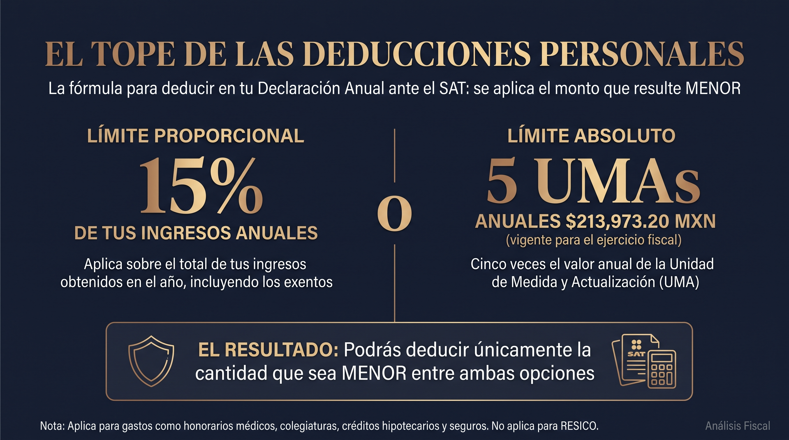

El pago de una póliza de **Gastos Médicos Mayores (GMM)** no solo representa un blindaje indispensable ante contingencias de salud; en el marco tributario mexicano, es también una de las **herramientas de optimización fiscal más eficientes para Personas Físicas**.

Si eres médico especialista, empresario o profesionista independiente, el Servicio de Administración Tributaria (SAT) te permite clasificar la prima total pagada por ti, tu cónyuge, hijos o padres como una **deducción personal**, reduciendo directamente la base sobre la cual se calcula tu ISR anual y generando, en muchos casos, un saldo a favor.

## Requisitos Indispensables para Hacer Deducible tu Póliza

Para que el SAT valide sin objeciones la devolución de tu impuesto, la factura (CFDI) emitida por la aseguradora debe cumplir rigurosamente con los siguientes tres parámetros:

### 1. Forma de Pago Bancarizada (Cero Efectivo)

El pago de la prima debe realizarse mediante **medios electrónicos rastreables**:

- Tarjeta de crédito o débito a nombre del titular.
- Transferencia electrónica de fondos (SPEI).
- Cheque nominativo del contribuyente.

> ⚠️ **Atención:** Si realizas el pago en efectivo en ventanilla bancaria o en tienda de conveniencia, la factura será **invalidada automáticamente** como deducción personal por los sistemas informáticos del SAT.

### 2. Uso correcto del CFDI y Clave de Producto/Servicio

Al solicitar la factura a tu aseguradora o despacho de corretaje, asegúrate de que el campo **Uso de CFDI** contenga la opción:

- **`D07 - Primas por seguros de gastos médicos`**

Asimismo, verifica que la clave de producto corresponda a *Servicios de Seguros de Salud o Gastos Médicos* (`84131500`).

### 3. Parentesco Directo y Dependencia Económica

Puedes deducir las pólizas contratadas para:

- Tu propia cobertura (titular).
- Tu cónyuge o concubino(a).
- Tus ascendientes en línea recta (padres, abuelos).
- Tus descendientes en línea recta (hijos, nietos).

**Requisito clave:** Las personas mencionadas no deben haber percibido ingresos iguales o superiores a 1 UMA elevada al año durante el ejercicio fiscal.

## ¿Cuánto es lo máximo que puedes deducir en 2026? (Límite de UMAS)

De acuerdo con la Ley del Impuesto Sobre la Renta (LISR, Art. 151), las deducciones personales están topadas al valor de lo que resulte menor entre dos factores:

1. El **15% del total de tus ingresos anuales** acumulables.
2. El equivalente a **5 UMAS anuales** (Unidad de Medida y Actualización).

### Ejemplo de Optimización Fiscal

Si tus ingresos anuales brutos son de **$1,500,000 MXN**:

- El 15% de tus ingresos equivale a **$225,000 MXN**.
- El tope por 5 UMAS anuales suele ubicarse sensiblemente por debajo de dicha cifra.
- Por lo tanto, podrás deducir tus primas de Gastos Médicos Mayores hasta por el monto máximo permitido por las 5 UMAS, generando una devolución sustancial sobre la tasa marginal del ISR (que para ese nivel de ingresos puede alcanzar hasta el 30%-35%).

## Situación Especial: ¿Qué pasa si estás en RESICO?

El Régimen Simplificado de Confianza (RESICO) ofrece tasas preferenciales de ISR (del 1% al 2.5%). Sin embargo, como contrapartida legal, **los contribuyentes en RESICO no pueden aplicar deducciones personales** en su declaración anual, incluyendo las primas de Gastos Médicos Mayores.

Si tributas en RESICO o planeas cambiar de régimen, en **Nubenca** estructuramos estrategias de protección con visión patrimonial que se ajustan exactamente a tu arquitectura fiscal actual.

## Audita tu Póliza y Estructura tu Estrategia Fiscal

No permitas que una factura mal emitida o una forma de pago incorrecta entorpezcan tu saldo a favor en la próxima declaración anual.

En **Nubenca Concierge**, no solo comparamos coberturas con las aseguradoras líderes del país; **diseñamos la arquitectura de tu póliza en coordinación con tus objetivos fiscales**.
