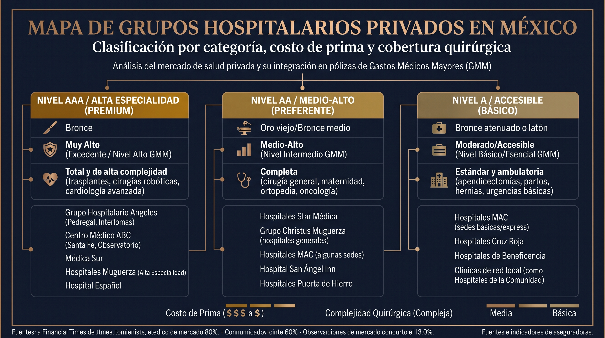

Al contratar un **Seguro de Gastos Médicos Mayores (GMM)**, uno de los factores que más encarece la prima anual es la selección de la **red hospitalaria**. La mayoría de las personas asume que contratar el nivel más alto ("Hospitales AAA") es siempre la única opción prudente. Sin embargo, en la práctica de la arquitectura financiera de seguros, esta decisión no siempre es la más eficiente.

Elegir un nivel hospitalario inadecuado puede significar un **sobrecosto de entre un 30% y un 60% en tu pago anual**, o peor aún, enfrentarte a penalizaciones de coaseguro si te atiendes en un hospital superior al contratado en tu póliza.

A continuación, te mostramos cómo analizar objetivamente qué nivel hospitalario requiere realmente tu perfil y zona geográfica.

## 1. La Clasificación Hospitalaria en México: AAA vs. AA vs. A

Las aseguradoras dividen las instituciones de salud privadas en categorías según su infraestructura, tecnología de diagnóstico, prestigio y costos de estancia por noche.

### Nivel AAA (Alta Especialidad y Prestigio Internacional)

- **Ejemplos representativos:** Centro Médico ABC (Observatorio y Santa Fe), Hospital Español, Médica Sur, Grupo Ángeles (principales sedes) y hospitales equivalentes en zonas costeras y regionales como Puerto Vallarta y Guadalajara.
- **Características:** Unidades de terapia intensiva de última generación, robots quirúrgicos (Da Vinci) y todas las subespecialidades médicas disponibles 24/7.
- **Impacto Financiero:** Incrementa sustancialmente el costo de la prima. Ideal si resides cerca de estos centros o si buscas atención de ultra-especialidad sin restricciones.

### Nivel AA (Hospitales Ejecutivos y Regionales de Alto Nivel)

- **Ejemplos representativos:** Sedes regionales de Grupo San José, hospitales San Javier/Joya intermedios, Hospitales Mac y redes de centros médicos de especialidad en zonas urbanas emergentes.
- **Características:** Quirófanos modernos, habitaciones privadas de alto confort, áreas de urgencias totalmente equipadas para resolver más del 95% de las contingencias médicas complejas.
- **Impacto Financiero:** Es el **"punto dulce" financiero**. Ofrece una reducción significativa en la prima respecto al nivel AAA con una atención médica impecable.

### Nivel A (Clínicas de Atención Primaria y Maternidad)

- **Características:** Centros enfocados en cirugía ambulatoria, procedimientos programados de menor complejidad y maternidad sin complicaciones.
- **Impacto Financiero:** Primas muy accesibles, pero con limitaciones en casos de enfermedades raras o terapias de alta especialidad tecnológica.

## 2. La Regla del "Costo de Oportunidad": ¿Vale la pena pagar Nivel AAA?

Para definir si te conviene contratar el nivel hospitalario más alto, hazte estas 3 preguntas tácticas:

1. **¿Dónde resides habitualmente?** Si vives en una ciudad donde el hospital más cercano y equipado es de nivel AA (por ejemplo, en ciudades costeras o medianas), pagar una póliza con nivel AAA solo se justificará si estás dispuesto a trasladarte a CDMX, Guadalajara o Monterrey para cualquier tratamiento.
2. **¿Tienes opción de subir de nivel mediante penalización controlada?** La mayoría de las pólizas te permiten atenderte en un hospital de nivel superior al contratado, aplicando un incremento en el coaseguro (por ejemplo, un 10% o 20% adicional sobre la factura total). Para eventos poco probables, pagar esta diferencia en el evento puede ser numéricamente más barato que pagar el sobrecosto de la prima AAA durante 10 años consecutivos.
3. **¿Cuál es tu equipo médico de cabecera?** Si tus médicos o cirujanos de confianza operan principalmente en hospitales Nivel AA, contratar Nivel AAA es un desperdicio de capital.

## 3. Cláusulas de Emergencia fuera de tu Red Contratada

Es crucial recordar que en **situaciones de emergencia real donde corra peligro inminente la vida**, las pólizas bien estructuradas cubren la atención inicial para la estabilización del paciente en cualquier hospital (incluso si es de nivel superior al contratado), antes de coordinar un traslado seguro.

## Optimiza el Nivel Hospitalario de tu Póliza

En **Nubenca Concierge**, auditamos tu ubicación geográfica, hábitos de viaje y presupuesto para seleccionar la red hospitalaria exacta. Diseñamos combinaciones de deducible, coaseguro y nivel de hospital para que no pagues ni un solo peso de más.
