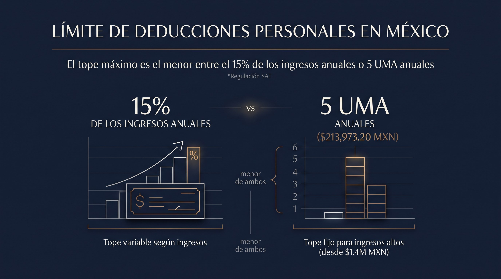

Ante un evento de salud de alta especialidad o una emergencia imprevista en México, la diferencia entre acceder a la medicina privada de primer nivel y enfrentar un quebranto financiero reside en contar con una póliza de **Gastos Médicos Mayores (GMM)** adecuadamente estructurada.

Un Seguro de Gastos Médicos Mayores es un instrumento financiero y contractual mediante el cual una aseguradora asume la mayor parte de los costos derivados de atenciones hospitalarias, intervenciones quirúrgicas, tratamientos oncológicos o accidentes graves, a cambio de una prima anual.

## 1. ¿Para qué sirve realmente un GMM en el ecosistema privado?

El objetivo primario de un seguro de salud de gastos mayores no es cubrir consultas de rutina o medicamentos menores (los cuales corresponden a la medicina preventiva o de gastos menores). Su función real es **blindar tu patrimonio ante siniestros de alto impacto financiero**.

En el sistema privado mexicano, un día de estancia en terapia intensiva en un hospital de nivel AAA o un tratamiento de alta especialidad puede superar fácilmente los cientos de miles de pesos. El seguro absorbe la masa crítica de la factura, permitiendo que el asegurado aporte únicamente una fracción predeterminada (*deducible* y *coaseguro*).

## 2. Los 4 Pilares de Funcionamiento de una Póliza en México

Para evaluar y entender el funcionamiento de tu contrato ante la Comisión Nacional de Seguros y Fianzas (CNSF), debes dominar cuatro conceptos operativos clave:

1. **Suma Asegurada:** Es el monto límite máximo que la aseguradora pagará por cada enfermedad o accidente cubierto. En contratos ejecutivos, se sugiere buscar sumas aseguradas robustas o ilimitadas por evento.
2. **Deducible:** Es la cantidad fija con la que tú participas al inicio de cada nuevo padecimiento. Si el gasto médico es menor al deducible, corre por tu cuenta; si lo supera, se activa la responsabilidad de la aseguradora.
3. **Coaseguro:** Es un porcentaje (generalmente entre el 10% y el 20%) del total de los gastos cubiertos *después* de restar el deducible. Funciona para autorregular el uso del seguro y suele estar protegido por un **tope de coaseguro** (monto máximo que pagarás).
4. **Nivel o Red Hospitalaria:** Clasificación que determina en qué instituciones privadas ([Nivel AAA, AA o A](/blog/nivel-hospitales-seguro-gastos-medicos-mayores-mexico)) puedes ingresarte sin penalizaciones adicionales en tu participación.

## 3. ¿Qué gastos médicos sí están cubiertos?

Las pólizas estándar de alta especialidad en México suelen contemplar:

- **Honorarios Médicos y Quirúrgicos:** Consultas de diagnóstico, cirujanos, anestesiólogos y ayudantes.
- **Gastos Hospitalarios:** Habitación privada, uso de quirófano, terapia intensiva y medicamentos en internamiento.
- **Estudios de Diagnóstico de Alta Tecnología:** Resonancias magnéticas, tomografías, PET scans y laboratorios.
- **Tratamientos Continuos:** Quimioterapias, radioterapias, diálisis y rehabilitación postoperatoria.
- **Maternidad y Complicaciones:** Suma de apoyo para el nacimiento y cobertura integral para emergencias del recién nacido.

Qué tanto de cada rubro te conviene pagar depende directamente de cómo se estructuren el deducible, el coaseguro y la aseguradora — por eso vale la pena [comparar AXA, MetLife y GNP](/blog/axa-vs-metlife-vs-gnp-gastos-medicos-directivos) antes de firmar.

## 4. Deducibilidad Fiscal ante el SAT

En México, las primas pagadas por concepto de seguros de gastos médicos mayores son clasificadas como **deducciones personales** bajo el Artículo 151 de la Ley del Impuesto Sobre la Renta (LISR), lo que permite recuperar saldo a favor en la declaración anual de las Personas Físicas, siempre dentro del tope menor entre el 15% de tus ingresos anuales o 5 UMAs.

Si quieres el detalle completo de requisitos de CFDI, forma de pago y qué pasa si tributas en RESICO, revisa nuestra guía de [cómo deducir tu GMM ante el SAT](/blog/deducir-seguro-gastos-medicos-sat-2026).

## Estructura tu Cobertura con Visión Patrimonial

En **Nubenca Concierge**, eliminamos la complejidad burocrática y las letras pequeñas. Diseñamos la combinación exacta de deducible, coaseguro y red hospitalaria para tu perfil.
