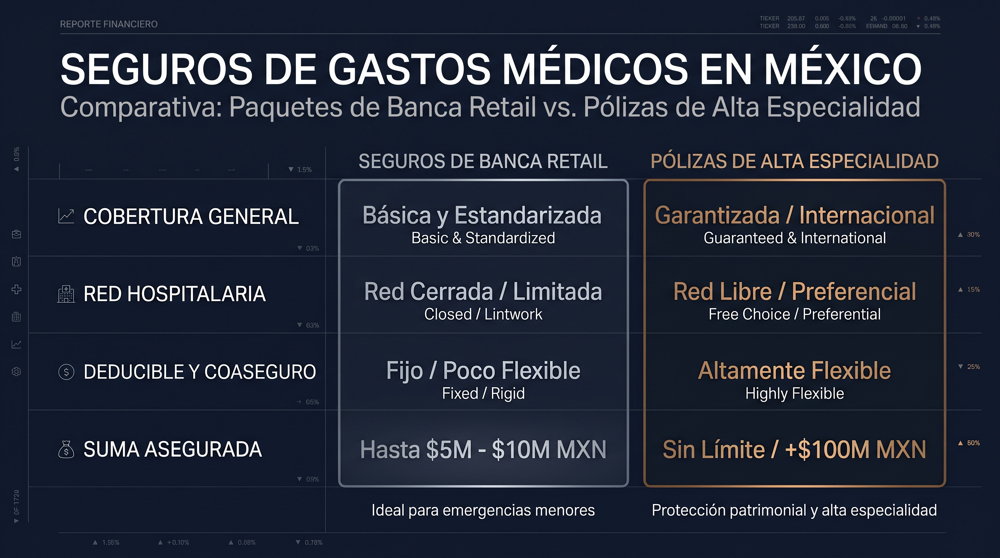

Es una escena cotidiana: al revisar tu banca en línea o acudir a una sucursal de instituciones como **BBVA, Inbursa o Banamex**, recibes promociones para contratar un **seguro de gastos médicos o salud** con cargo automático a tu tarjeta y contratación a pocos clics.

Aunque la conveniencia operativa de la banca comercial es atractiva para coberturas básicas, es indispensable analizar si estos productos estandarizados ofrecen el nivel de respuesta y flexibilidad que requiere un perfil directivo, profesional o empresarial ante una enfermedad grave o accidente.

## 1. Productos Bancarios Estandarizados vs. Pólizas Médicas Especializadas

La principal diferencia radica en el diseño del contrato y el canal de atención:

| Característica | Pólizas de Mostrador Bancario (BBVA, Inbursa) | Pólizas Especializadas (AXA, GNP, MetLife) |
| :--- | :--- | :--- |
| **Diseño del Contrato** | Paquetes cerrados estandarizados con opciones limitadas de deducible. | Módulo 100% personalizable (deducible, coaseguro, tabulador y red). |
| **Sumas Aseguradas** | Frecuentemente topadas o enfocadas en indemnizaciones fijas por día. | Sumas robustas diseñadas para cubrir padecimientos catastróficos. |
| **Atención en Siniestro** | Call center masivo y trámite por ventanilla. | Gestor de crisis / Concierge dedicado a la tramitación de cartas pase. |
| **Redes Hospitalarias** | Acceso a redes medias o restringidas según el nivel del paquete. | Opción de acceso a la red completa de Hospitales AAA en México y extranjero. |

Si aún no tienes claros conceptos como suma asegurada, deducible o coaseguro, empieza por nuestra guía de [qué es un Seguro de Gastos Médicos Mayores y cómo funciona](/blog/que-es-seguro-gastos-medicos-mayores-mexico).

## 2. Análisis por Institución: Lo que debes revisar

### BBVA Seguros (Salud y Gastos Médicos)

BBVA ha digitalizado de manera eficiente la venta de seguros. Sus esquemas suelen ser muy claros para **coberturas de indemnización, gastos menores o urgencias básicas**. Sin embargo, para perfiles que buscan atención en hospitales de alta gama con equipos quirúrgicos de libre elección, los tabuladores rígidos pueden generar desembolsos considerables por diferencia de honorarios.

### Inbursa Seguros

Inbursa cuenta con una división aseguradora de gran tradición e infraestructura sólida en ciertos sectores. Sus productos suelen tener costos competitivos; no obstante, la selección de su red médica y los procesos administrativos requieren una revisión detallada previa para garantizar que incluyan los hospitales y especialistas de tu preferencia — revisa qué implica cada [nivel hospitalario en tu póliza de GMM](/blog/nivel-hospitales-seguro-gastos-medicos-mayores-mexico) antes de firmar.

## 3. El Factor Crítico: La Gestión del Siniestro

El verdadero reto de contratar un seguro a través de un banco no ocurre al momento de pagar la prima, sino **al momento de tramitar un pago directo en urgencias o una programación de cirugía**.

1. **En la Banca Comercial:** La relación se gestiona mediante ejecutivos de sucursal (cuyo giro principal es financiero, no asegurador) o líneas telefónicas generales.
2. **Con una Firma Boutique (Nubenca):** Cuentas con un **Concierge Financiero** que asume la comunicación con la aseguradora, revisa los dictámenes médicos, coordina la exención o ajuste de deducibles y agiliza el ingreso hospitalario de tu familia.

## 4. ¿Cuándo sí conviene una opción bancaria?

Los seguros de gastos médicos bancarios son opciones funcionales como **cobertura complementaria de indemnización diaria** o para perfiles jóvenes que buscan una protección inicial básica contra accidentes.

Para familias, médicos, empresarios y directivos con un patrimonio que proteger, se recomienda migrar hacia **pólizas de alta especialidad con arquitectura personalizada**. Si estás en ese punto, nuestra [comparativa de AXA vs. MetLife vs. GNP para directivos](/blog/axa-vs-metlife-vs-gnp-gastos-medicos-directivos) te ayuda a elegir aseguradora.

## Audita tu Póliza Bancaria o Diseña una Cobertura a la Medida

En **Nubenca Concierge**, comparamos la propuesta de tu banco contra las opciones de las aseguradoras especialistas más sólidas del país.
