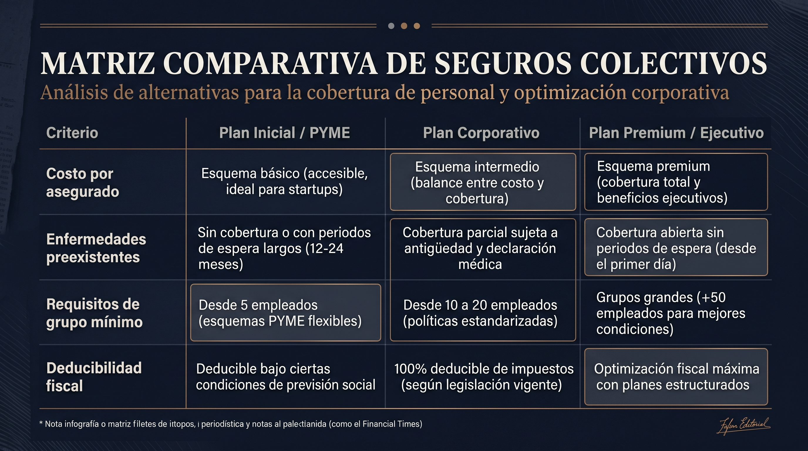

Al hacer crecer una empresa, clínica o firma de servicios, uno de los hitos más relevantes para la atracción de talento de alto nivel es la oferta de **prestaciones médicas de primer orden**. Sin embargo, los emprendedores y socios fundadores frecuentemente se enfrentan a un dilema financiero: **¿es mejor contratar pólizas individuales para cada integrante clave o estructurar una póliza colectiva / grupal?**

La decisión no solo impacta la liquidez de la empresa, sino también las condiciones de salud de los asegurados: **los esquemas colectivos cuentan con reglas distintas respecto a preexistencias, periodos de espera y tratamiento fiscal**.

## 1. Cuadro Comparativo: Colectivo vs. Individual de un Vistazo

Para evaluar la conveniencia de cada alternativa según la etapa de tu empresa, analizamos las variables críticas de ambas modalidades:

| Parámetro | Póliza Colectiva / Grupal (PyME) | Póliza Individual / Familiar |
| :--- | :--- | :--- |
| **Requisito de Integrantes** | Mínimo 5 a 10 asegurados principales (varía según aseguradora). | Sin mínimo (1 persona en adelante). |
| **Costo de la Prima** | **Hasta 20% - 40% más accesible** por economía de escala. | Tarifa personalizada según edad exacta y género de cada individuo. |
| **Tratamiento de Preexistencias** | Posibilidad de **eliminación o reducción de periodos de espera** para grupos maduros. | Aplican periodos de espera estrictos (1 a 2 años para padecimientos específicos). |
| **Deducibilidad Fiscal** | **100% Deducible para la Persona Moral** como previsión social (LISR Art. 27). | Deducible en la declaración anual de la Persona Física (Topado a 5 UMAS / 15% de ingresos). |
| **Portabilidad / Continuidad** | Requiere contratar el endoso de *Derecho a Conversión* para conservar antigüedad al salir. | La póliza le pertenece al titular de manera indefinida. |

## 2. Ventajas del Esquema Colectivo para Emprendedores y Socios

### A. Deducción al 100% como Previsión Social

Para una empresa (Persona Moral), las aportaciones pagadas por concepto de seguros de gastos médicos colectivos para sus trabajadores son **gastos estrictamente indispensables y 100% deducibles de ISR**, sin quedar sujetos al tope de las 5 UMAS de las deducciones personales físicas.

### B. Eliminación de Periodos de Espera

En pólizas individuales, padecimientos como litiasis, hernias, afecciones de columna o padecimientos ginecológicos requieren entre 12 y 24 meses de antigüedad continua para estar cubiertos. En las pólizas colectivas bien negociadas, las aseguradoras aceptan **eliminar los periodos de espera desde el día uno**, respaldando la salud del equipo de manera inmediata.

### C. Retención de Talento Directivo

Para perfiles clave (C-Level, médicos especialistas o ingenieros senior), contar con una cobertura en hospitales de Nivel AAA sin costo directo para su bolsillo funciona como un incentivo de permanencia superior a un incremento salarial directo (el cual genera carga impositiva adicional).

## 3. ¿Cuándo conviene mantenerse en un Esquema Individual?

A pesar de la eficiencia en costos del seguro colectivo, la póliza individual sigue siendo la opción recomendada cuando:

1. **Tu equipo es menor a 5 personas:** La mayoría de las aseguradoras de alta especialidad (AXA, GNP, MetLife) requieren un grupo mínimo para abrir la colectividad PyME.
2. **Buscas independencia laboral:** Si eres socio o profesional independiente y prefieres que la continuidad de tu seguro y tu antigüedad acumulada no dependan de la razón social o permanencia de una empresa.
3. **Deseas personalización total:** En una colectividad, los deducibles, coaseguros y niveles hospitalarios suelen estandarizarse para todo el grupo o por jerarquía, mientras que en una póliza individual puedes definir cada variable a la medida exacta de tus necesidades familiares.

## Estrategia Mixta: Lo Mejor de Ambos Mundos

Una arquitectura común implementada por **Nubenca** para fundadores y directivos consiste en mantener una **Póliza Colectiva base provista por la empresa**, complementada con un **Seguro de Exceso o Reconocimiento de Antigüedad Individual**. Esto garantiza costos optimizados hoy y protección patrimonial vitalicia sin importar cambios corporativos futuros.

## Audita la Cobertura Médica de tu Empresa o Equipo

En **Nubenca Concierge**, analizamos la nómina o estructura de socios de tu empresa para cotizar opciones colectivas e individuales, presentando una comparativa cuantitativa en menos de 24 horas.
