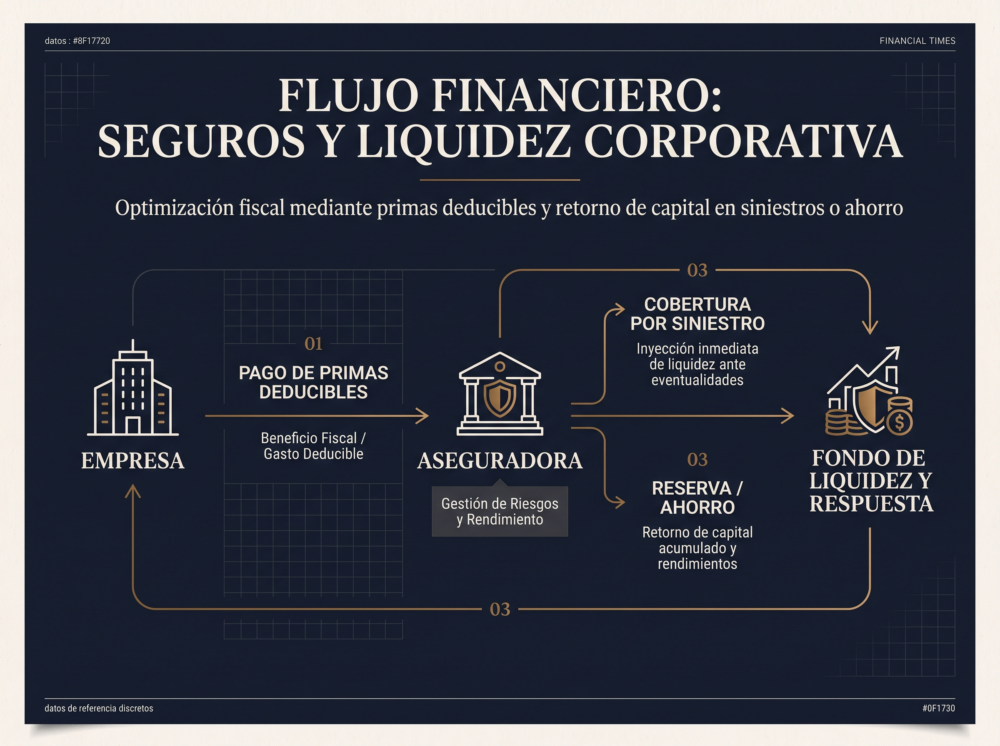

En el ecosistema empresarial, el valor de una organización rara vez reside únicamente en sus activos físicos o en sus cuentas bancarias. Con frecuencia, **el activo más valioso es el talento, las relaciones comerciales o el conocimiento técnico de una persona clave**: un socio fundador, el director general, un médico especialista estrella o el desarrollador principal de la firma.

La pérdida inesperada de esta figura (por fallecimiento o invalidez total y permanente) representa un riesgo operativo y financiero crítico. El **Seguro de Hombre Clave** (o Técnico Especialmente Valioso) es la herramienta corporativa diseñada para blindar a la empresa ante este escenario, funcionando simultáneamente como un **eficiente escudo fiscal**.

## 1. ¿Qué es y cómo funciona el Seguro de Hombre Clave?

A diferencia de un seguro de vida personal tradicional donde los beneficiarios son la familia o cónyuge, en el **Seguro de Hombre Clave la propia empresa actúa como contratante, pagadora de las primas y beneficiaria preferente e irrevocable**.

Ante la eventualidad de fallecimiento o invalidez definitiva del directivo o socio asegurado, la empresa recibe una **suma asegurada en efectivo** que le permite:

- **Absorber el impacto económico:** Compensar la disminución temporal de ingresos o ventas.
- **Financiar la sucesión y reclutamiento:** Contratar y capacitar a un reemplazo de alto nivel sin asfixiar el flujo de caja.
- **Liquidez para la compra de acciones:** En sociedades entre socios, la liquidez permite comprar la participación del socio fallecido a sus herederos, evitando la intromisión de terceros no deseados en la toma de decisiones.
- **Respaldo a créditos bancarios:** Garantizar compromisos de deuda corporativa que dependían de la firma del ejecutivo.

## 2. Requisitos Legales de la LISR para la Empresa

Para que la póliza mantenga validez legal y beneficios fiscales en México bajo la **Ley del Impuesto sobre la Renta (LISR, Art. 27, Fracción XII)**, debe cumplir estrictamente con las siguientes reglas:

1. **Relación Laboral o Mercantil Demostrable:** El asegurado debe tener una relación técnica o directiva fundamental para la generación de ingresos de la empresa.
2. **Plazos del Contrato:** Los planes deben estructurarse a plazos fijos (habitualmente de 10 a 20 años).
3. **Sin Préstamos sobre la Póliza:** La empresa no puede realizar préstamos garantizados sobre la póliza durante la vigencia del contrato deducible.

## 3. Beneficio Fiscal: Deducibilidad al 100% para la Empresa

El principal atractivo financiero de esta estrategia es su tratamiento tributario para personas morales en régimen general:

> **Las primas pagadas por la empresa para el Seguro de Hombre Clave son 100% deducibles de ISR como un gasto estrictamente indispensable.**

### Retorno por Dinero al Vencimiento (Estrategia de Fondos Corporativos)

Si al finalizar el plazo del contrato (por ejemplo, 10 años) no ocurrió ningún evento de invalidez o fallecimiento, la póliza puede consolidarse con un **valor de rescate acumulado**:

- La empresa recupera el capital acumulado durante la década.
- Dicho importe ingresa a la contabilidad de la empresa como un ingreso acumulable, habiendo permitido durante 10 años **diferir o reducir el pago de impuestos anuales**, funcionando como una reserva corporativa estratégica para la jubilación del socio o bonos de retención de talento.

## 4. ¿Para qué perfiles corporativos está diseñado?

- **Socios de PyMEs y Startups:** Empresas de 2 a 10 socios donde la ausencia de uno obligaría a negociar con herederos o cerrar operaciones.
- **Clínicas y Grupos Médicos:** Centros de salud que dependen de la facturación y prestigio de médicos especialistas clave.
- **Empresas Familiares:** Para garantizar la transición ordenada hacia la siguiente generación sin comprometer el capital de trabajo.

## Diseña la Estrategia de Blindaje Corporativo para tus Socios

En **Nubenca Concierge**, evaluamos la estructura accionaria y fiscal de tu empresa para diseñar una póliza de Hombre Clave ajustada a los estatutos de tu sociedad y a tu proyección de flujos.
